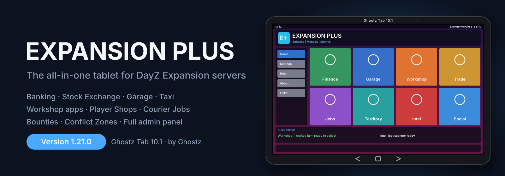

<p align="center">
  <picture>
    <source media="(prefers-color-scheme: dark)" srcset="banner-dark.svg">
    <source media="(prefers-color-scheme: light)" srcset="banner-light.svg">
    
  </picture>
</p>

<p align="center">
  <a href="https://ghostz43.github.io/expansion-plus-wiki/"><b>📖 Read the wiki</b></a> ·
  <a href="https://steamcommunity.com/sharedfiles/filedetails/?id=3832964217">Steam Workshop</a> ·
  <a href="https://discord.gg/waZrD357wZ">Discord</a> ·
  <a href="https://buymeacoffee.com/ghostzgaming">Buy me a coffee</a>
</p>

# Expansion Plus Wiki

The official wiki for **Expansion Plus**, the all-in-one add-on for **DayZ Expansion** servers by Ghostz Gaming.

Banking, a stock exchange, a full vehicle garage, player shops, territory rent, courier jobs, bounties, conflict zones, messaging and the **Workshop** survival tools, all on one in-game device: the **Ghostz Tab 10.1**.

| | |
| --- | --- |
| **Version** | 1.20.0 |
| **Workshop ID** | 3832964217 |
| **Needs** | CF, Dabs Framework, DayZ-Expansion-Licensed, DayZ-Expansion-Bundle |
| **Keys** | F7 tablet · F5 Workshop hub · F8 admin · F9 server info · K garage · Numpad 0 cruise |

> [!IMPORTANT]
> **Ghostz QoL Plus is built into Expansion Plus since 1.20.0.** Remove `@GhostzQoLPlus` from your server and modlist. All its settings, recipes and uncollected crafts are kept. See [Updating to 1.20](https://ghostz43.github.io/expansion-plus-wiki/updating.html).

## 📱 The Ghostz Tab 10.1

A physical tablet with **Back / Home / Forward** keys on the bezel and full page history. Apps are grouped into hubs, with a **Quick Status** strip for anything waiting for you.

| Hub | Apps |
| --- | --- |
| 💰 **Finance** | Bank (savings, group accounts, transfers, loans, online pay) · Survivor Stock Exchange |
| 🚗 **Garage** | Garage (store with cargo, dealer, player market, service, insurance, locks) · Taxi · Rent-a-Ride & Tracker · Vehicle Dashboard |
| 🛠️ **Workshop** | Inventory Manager · Crafting · Repair · Drying Station (a working washer-dryer) · Gear Appraisal |
| 🏪 **Trade** | Player shops (placeable container shops, wholesale, ratings) · Community donations |
| 📦 **Jobs** | Courier contracts · Quests & missions · Bounties |
| 🚩 **Territory** | Territory rent by base size · Conflict zones with daily income and production |
| 📡 **Intel** | Loot Scanner with a radar scope and in-world markers |
| 💬 **Social** | Messenger, admin calls, notifications, leaderboards, reviews, server info (F9) |

## 👑 Control Room (F8)

An **ALL TOOLS** page grouped by hub; live settings; admin roles and one admin list; market editor, trader restock, file editor with JSON checks; players, wipes, economy tracking, trade log; admin log with **undo**; garage, taxi, zones, map markers and stock exchange control; and **Workshop Admin Control** for the Workshop apps.

## 🚀 Quick start

1. Install the requirements: CF, Dabs Framework, DayZ-Expansion-Licensed and DayZ-Expansion-Bundle.
2. Copy `@GhostzSuite` to your server and `keys/Ghostz.bikey` into the server's `keys` folder.
3. Load it last:
   ```
   -mod=@CF;@Dabs Framework;@DayZ-Expansion-Licensed;@DayZ-Expansion-Bundle;@GhostzSuite
   ```
4. Turn on the Expansion ATM (`"ATMSystemEnabled": 1` in `MarketSettings.json`).
5. Add your Steam64 ID to `Admins` in `profiles/GhostzSuite/Settings.json`, restart, then press **F8** in game.

Full steps are on the [Getting started](https://ghostz43.github.io/expansion-plus-wiki/getting-started.html) page.

## 📚 What's in the wiki

| Section | Pages |
| --- | --- |
| Getting started | Introduction · Install and first admin · Updating to 1.20 · The tablet |
| Finance | Bank and online pay · Stock exchange |
| Garage | Garage · Taxi · Rentals and tracker · Vehicle dashboard |
| Workshop | Inventory · Crafting · Repair · Drying · Appraisal |
| Trade | Player shops · Donations and server info |
| Jobs | Courier contracts and quests · Bounties |
| Territory | Territory rent · Conflict zones |
| Intel & Social | Loot scanner · Messages |
| Admins | Admin panel · Workshop admin · Restock · Market editor · Garage admin |
| Reference | Every setting with its default · Files and folders · Troubleshooting · Changelog |

The wiki has search (**Ctrl + K**), **dark and light modes** (it follows your device until you pick one), and works on phones.

## About this repository

This repository holds the published website: plain HTML, CSS and JavaScript served by GitHub Pages, with no build step online. Each page is built from Markdown sources kept by the mod's author, and the settings reference is generated from the mod's own source code.

## Support

Questions, bugs or ideas? Join the [Discord](https://discord.gg/waZrD357wZ).

---

Expansion Plus © Ghostz Gaming. Expansion Plus is a free mod; all money in it is in-game currency only. DayZ is a trademark of Bohemia Interactive. This project is not affiliated with Bohemia Interactive or the DayZ Expansion team.
